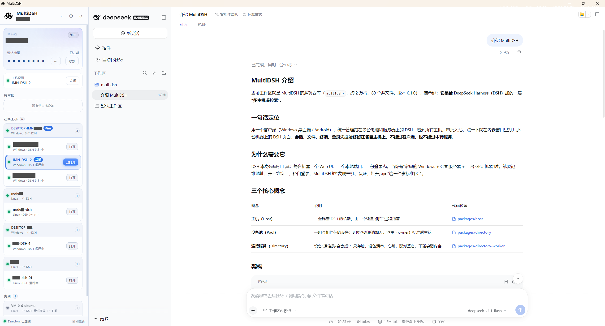

# 再三求索（MultiDSH）

再三求索（MultiDSH）是一个多主机客户端。它管理多台电脑和服务器上的 DeepSeek Harness（简称 DSH）。

你可以在 Windows 客户端或 Android 手机里看到已连接的主机。点击一台主机，即可打开对应的 DSH 页面。会话、文件、终端和登录信息仍保存在各自主机上。



## 基本概念

- **主机（host）**：运行 DeepSeek Harness 的电脑或服务器。
- **设备池（pool）**：一组互相信任的设备。新设备使用 8 位池码加入。池主批准后，设备生效。
- **连接服务（Directory）**：帮助设备互相发现的服务。**本项目不提供公共 Directory。** 你需要自己部署，或使用团队提供的实例。
- **Public URL**：其他设备打开这台主机时使用的地址。它可以是局域网地址，也可以是 HTTPS 隧道域名。

## 能做什么

- 一台电脑或服务器运行一个 DSH 主机
- 一个客户端管理多台主机
- 同一台机器可以运行多个独立的 DSH 实例
- 用设备池管理哪些设备可以互相访问
- 新设备加入需要池主批准
- Windows 客户端包含界面运行时。要运行主机时，可在设置中安装 Node/DSH。

## 下载

在 GitHub 的 **Releases** 页面下载：

- [Windows 桌面端](releases/latest/download/MultiDSH-windows-0.1.0.zip)
- [Linux 服务器](releases/latest/download/MultiDSH-linux-host-0.1.0.tar.gz)
- [Android 客户端](releases/latest/download/MultiDSH-android-0.2.0.apk)（安装时需允许未知应用）

也可以打开 [所有版本](releases/latest)。

支持的系统：

- Windows 10 / 11（桌面客户端）
- Linux 服务器：Ubuntu 22.04+ / Debian 12+（推荐）
- Android 8.0+（客户端）

---

## 快速开始

### 第 0 步：准备 Directory（必须）

本项目不提供公共 Directory。开始前，请准备一个所有客户端都能访问的 HTTPS Directory 地址。你可以自己部署，也可以使用团队已有的实例。

自建 Directory 需要：

- 一个 Cloudflare 账号
- 一个已接入 Cloudflare 的域名，或一个 `*.workers.dev` 子域
- Node.js 22 或 24
- 本仓库源码

完整条件、D1 和 Worker 部署步骤、验收方法见 [在 Cloudflare 上部署 Directory](docs/CLOUDFLARE-DEPLOY.md)。

### 第 1 步：打开 Windows 客户端

1. 下载 Windows 桌面端压缩包
2. 解压到一个普通文件夹，例如 `D:\MultiDSH`
   - 不建议放在 OneDrive 或其他网盘同步目录
3. 双击 `MultiDSH.exe`

第一次打开会进入正式引导页，不会自动展示演示数据。  
想先看界面示例，可以在 **设置 → 演示模式** 里手动进入；演示不会连接任何服务器。

> Windows 可能提示“未知发布者”，选择“仍要运行”即可。

第一次使用时，请在 **设置 → Directory 地址** 中填写第 0 步准备的地址。

### 本机 DSH 实例

在 **设置 → DSH 主机实例** 里可以：

- 新建实例并加入当前池
- 启动 / 停止 / 删除实例
- **编辑已有实例**：改名、Public URL、admin/dsh 端口、DSH bin.js、node.exe、DSH_HOME
- 点 **安装 Node/DSH** 一键把 Node、npm 和 `@deepseek-ai/dsh` 安装到本机用户目录

每个实例有独立的 `host.json`、`DSH_HOME` 和端口，互不影响。  
修改端口或 DSH bin.js 会自动重启该实例；改名和 Public URL 会随心跳同步到连接服务。  
本机客户端会立即显示新名字；其他客户端在收到下一次心跳/刷新后更新。

> **打开速度提示（0.1.x 起）**
> - 主机在本机时，客户端按设备 ID 改用 `127.0.0.1` 直连。它不经过 Cloudflare 隧道。首开通常小于 1 秒，之后每次交互也走本地。
> - 其他设备仍通过 Public URL 访问本机。即使只在这台机器上使用，也请保留一个可用的 Public URL。
> - 客户端会把打开过的主机页面留在内存。关闭页面只是隐藏。再次点击“打开”会直接显示。默认保留 3 个页面。你可以在 **设置 → 连接与外观 → 主机页签缓存** 调整（1–6）。设为 1 时只保留当前页。每页约占 100–200 MB 内存。

### 第 2 步：创建一个设备池

在客户端左侧点击 **创建池**。  
如果服务端启用了创建密钥，请在“创建密钥”中填写团队管理员提供的密钥。没有启用就留空。

创建成功后会得到一个 8 位池码，例如：

```text
ABCD1234
```

池码默认隐藏。点击旁边的 **显示** 可以查看池码。复制按钮不受隐藏状态影响。  
请保存池码。下一步会用到。池码是加入凭证，请只发给可信任的人。

### 第 3 步：把 Linux 服务器加入

1. 从 Releases 下载 Linux 服务器压缩包
2. 把压缩包上传到服务器（可以用 WinSCP、FileZilla，或在命令行用 `scp`）
3. 登录服务器，解压并运行：

```bash
tar xzf MultiDSH-linux-host-0.1.0.tar.gz -C ~
cd ~/multidsh
./install.sh
```

如果提示没有执行权限，用：

```bash
bash install.sh
```

安装器会自动准备 Node 和 DSH，然后依次询问：

| 问题 | 怎么填 |
|---|---|
| 连接服务（Directory）地址 | 填写与 Windows 客户端相同的地址 |
| 池码 | 粘贴刚才的 8 位池码 |
| 主机名字 | 直接回车，使用默认名字 |
| 端口 | 直接回车 |
| Public URL | 同一局域网直接回车；需要外网访问时见下方说明 |
| DSH 数据目录 | 直接回车；这里会保存 DSH 登录信息 |

最后确认创建。

> 如果只是先安装、不加入池，池码处直接回车即可；以后重新运行安装器可以再加入。

### 第 4 步：批准新主机

Linux 安装完成后，回到 Windows 客户端：

1. 在左侧找到 **待审批**
2. 找到刚加入的主机
3. 点击 **批准**

批准后，这台主机就会出现在 **在线主机** 里。

### 第 5 步：打开主机

点击主机卡片上的 **打开**，客户端会显示这台 Linux 服务器上的 DSH 页面。

之后你就可以像使用本机 DSH 一样使用它。

---

## 只在 Windows 上使用

可以。Windows 客户端本身也可以运行本机 DSH：

1. 打开客户端右上角的 **设置**
2. 找到 **本机主机**
3. 点击 **启动**
4. 回到主界面，批准这台本机主机
5. 点击 **打开**

这样不需要 Linux 服务器也能体验完整流程。

---

## Android 客户端

1. 下载 Android 客户端
2. 在手机上允许“安装未知应用”
3. 安装并打开
4. 在 Directory 地址中填写与 Windows 客户端相同的地址
5. 输入 Windows 客户端里的 8 位池码
6. 回到 Windows 客户端批准这台 Android 设备
7. 在 Android 上点主机 **打开**

Android 当前只作为客户端。它不在手机上运行 DSH 主机。  
0.2.0 增加了原生顶部栏、浅色默认主题、设置页、设备分组、审批/吊销二次确认、
配对/主机打开返回流程，以及 Android Keystore 加密保存设备 token。  
Android Host 暂不支持。主机请运行在 Windows 或 Linux。分析见
[Android Host 可行性分析](docs/ANDROID-HOST.md)。

---

## 外网访问和 Public URL

`Public URL` 是客户端打开这台主机时使用的地址。

如果 Windows 客户端和 Linux 服务器在同一个局域网，安装时请填写服务器的局域网地址，例如 `http://192.168.1.20:4080`。

如果服务器在云端，或你需要从外网访问它，请为服务器配置外部地址。推荐使用 Cloudflare Tunnel：

- 服务器不需要公网 IP
- 不需要在路由器上开放端口
- 每台主机使用一个子域名，例如 `dsh-01.example.com`

完整步骤见：

[**Cloudflare Tunnel 配置教程**](docs/CLOUDFLARE-TUNNEL.md)

---

## 常见问题

### 打开 exe 没有反应 / 没有窗口

请先关闭程序。把整个文件夹从 OneDrive、坚果云等同步目录移到本地普通目录，例如 `D:\MultiDSH`。然后再次双击。

### 客户端显示主机离线

1. 确认 Linux 主机仍在运行
2. 确认 Windows 和主机使用同一个连接服务（Directory）地址
3. 在客户端等待几秒，或重新打开客户端
4. 如果主机在公网，检查 Tunnel 是否正常

### 点击“打开”后页面打不开

通常是 `Public URL` 不正确，或该地址从客户端所在网络无法访问。

- 同一局域网：应该填服务器的局域网地址
- 外网访问：需要配置 Tunnel，不能填 `127.0.0.1`
- 不要填 DSH 内部端口 `3080`，客户端访问的是 `4080`

### 更新客户端后，池和数据会丢吗？

不会。Windows 客户端的数据默认保存在：

```text
%APPDATA%\MultiDSH
```

覆盖 exe、解压新版本都不会删除这个目录。

### 需要自己部署连接服务吗？

需要。本项目不提供公共 Directory。你可以自己部署，也可以使用团队已有的实例。

自建 Directory 的条件和步骤见：

[**在 Cloudflare 上部署 Directory**](docs/CLOUDFLARE-DEPLOY.md)

### 是否安全？

- 设备池需要池码才能加入
- 新设备需要池主批准
- 会话、文件、终端和登录信息保存在各自的主机上
- 公网访问时请使用 HTTPS
- 只开放主机的 4080 端口，不要开放 3080

---

## 更多文档

- [Linux 服务器安装说明](docs/INSTALL-LINUX.md)
- [Cloudflare Tunnel 配置](docs/CLOUDFLARE-TUNNEL.md)
- [部署自己的连接服务](docs/CLOUDFLARE-DEPLOY.md)
- [同一台机器运行多个 DSH](docs/MULTI-INSTANCE.md)
- [在本机加入设备池](docs/LOCAL-HOST.md)
